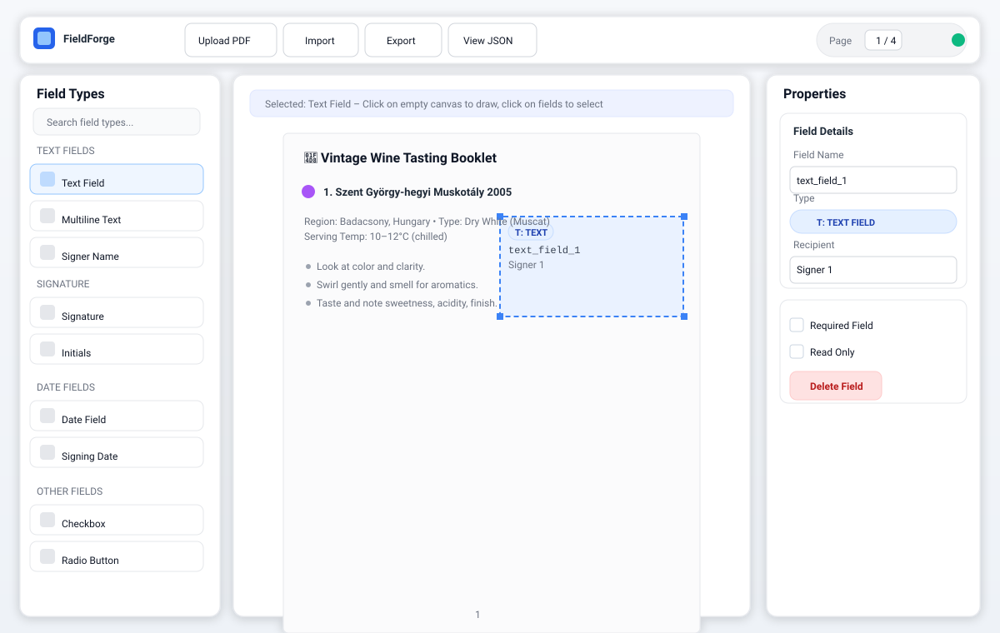

# FieldForge - PDF Field Mapper for Adobe Sign



A professional-grade visual PDF field mapping tool that allows you to configure Adobe Sign form fields without leaving your application. This Angular-based solution demonstrates how to embed document preparation capabilities directly into your own applications, eliminating the need to switch to Adobe Sign's interface.

🚀 **[Live Demo](https://pdfmapper.misu-varga.com/)** | 📖 **[Read the Article](https://misu-varga.com/blog/article/15)**

## Overview

While Adobe Sign provides its own interface for adding form fields to documents, requiring users to leave your application disrupts workflows and creates training overhead. FieldForge proves that field mapping can be seamlessly integrated into your existing applications using Adobe Sign's API.

### Key Features

#### Core Functionality

- 📄 **Visual PDF rendering** with PDF.js
- ✏️ **Intuitive field creation** - Click to select, click empty space to draw
- 🎯 **Precise positioning** with coordinate grid overlay and snap-to-grid
- 📝 **Complete Adobe Sign field support** (text, signature, date, checkbox, radio, etc.)
- 🔄 **Drag & resize** fields with visual handles
- ⚡ **Undo/Redo** with full history management

#### Professional UX/UI

- 🎨 **Modern three-panel layout** - Field types, canvas, and properties
- 🔍 **Smart context-aware interaction** - No mode switching needed
- 📋 **Collapsible sidebars** for maximum workspace
- 🎭 **Real-time visual feedback** with selection handles and hover states
- 📱 **Responsive design** that adapts to different screen sizes

#### Data Management

- 💾 **Import/Export** field configurations as JSON
- 📊 **JSON viewer** with copy-to-clipboard functionality
- 🔄 **Adobe Sign API-compatible** export (the "Adobe JSON" button writes a `formFields` array)
- 💼 **Configuration persistence** for workflow automation

#### Enterprise Features

- 🏗️ **Service-based architecture** with separation of concerns
- 🎯 **Coordinate conversion service** for TRANSIENT/LIBRARY modes
- 🖱️ **Field interaction service** for drag/resize operations
- 🎨 **Canvas renderer service** for optimized drawing
- 📐 **Type-safe field definitions** with comprehensive validation

## How It Works

FieldForge uses an intuitive context-aware interaction model:

1. **Select a field type** from the left sidebar
2. **Click on the PDF canvas**:
   - Click on **empty space** → Creates a new field of the selected type
   - Click on **existing field** → Selects it for editing/moving
3. **Resize or move** selected fields with visual handles
4. **Configure properties** in the right sidebar
5. **Export** your field configuration to JSON for Adobe Sign API

No mode switching, no complex interactions - just natural, intuitive field creation!

## Use Cases

- **Enterprise Applications**: Embed document configuration directly in your business applications
- **Document Management Systems**: Add field mapping as a native feature
- **CRM Integration**: Configure contracts without leaving your CRM
- **Workflow Automation**: Programmatically generate field configurations
- **Template Management**: Create reusable document templates

## Technical Stack

- **Angular 20**: Modern component-based architecture
- **PDF.js 5.3.31**: Client-side PDF rendering
- **Ant Design (ng-zorro) v20**: Professional UI component library
- **TypeScript 5.8**: Type-safe development with strict mode
- **Angular signals**: State lives in signals; components are `OnPush`
- **Enterprise Architecture**: Service-based separation of concerns

## Architecture Highlights

### Service Layer

- **CoordinateConversionService**: Handles PDF coordinate transformations
- **FieldInteractionService**: Drag and resize maths and the resize handles
- **FieldEditorService**: What a mouse press, move or release means (select, move, resize, draw), plus undo, delete and the document-type change
- **CanvasRendererService**: Canvas drawing operations
- **FieldTypeService**: Centralized field type definitions and metadata
- **HistoryService**: Undo/redo functionality with command pattern
- **PdfFieldService**: The list of fields (every change is undoable)
- **PdfDocumentService**: Loads the PDF and renders one page at a time
- **EditorStateService**: Grid, snap, selection, sidebars and the other UI state
- **FileActionsService**: Open a PDF, import / export JSON, the JSON dialog

### Component Structure

- **Standalone components**: Modern Angular architecture
- **Clean separation**: UI, business logic, and services
- **Type safety**: Comprehensive interfaces and models
- **Reactive patterns**: Signal-based state management

## Getting Started

### Prerequisites

- Node.js (v20.19 or higher recommended)
- npm or yarn
- Angular CLI (`npm install -g @angular/cli`)

### Installation

1. Clone the repository:

```bash
git clone https://github.com/vmisu86/pdf-field-mapper.git
cd pdf-field-mapper
```

2. Install dependencies:

```bash
npm install
```

3. Start the development server:

```bash
ng serve
```

4. Open your browser and navigate to http://localhost:4200/

## Usage

### Creating Fields

1. Upload a PDF document
2. Select a field type from the left sidebar (e.g., "Text Field", "Signature")
3. Click and drag on the PDF to create the field
4. Adjust properties in the right sidebar

### Managing Fields

- **Select**: Click on any field
- **Move**: Drag a selected field
- **Resize**: Drag the handles on a selected field
- **Delete**: Select a field and click "Delete Field" in the properties panel
- **Edit**: Modify field properties in the right sidebar

### Import/Export

- **Export**: Click "Export" to download your field configuration (FieldForge's own format: the fields, the coordinate system and the page count) as JSON
- **Adobe JSON**: Click "Adobe JSON" to download just the `formFields` array, in the shape Adobe Sign takes (no UI ids, `locations` as an array)
- **Import**: Click "Import" to load either file. A field with several `locations` becomes one field per location, and anything unusable is skipped with a note saying why. Import is a single undo step
- **View JSON**: Click "View JSON" to see and copy the raw configuration

### Keyboard Shortcuts

- `Ctrl+Z`: Undo
- `Ctrl+Shift+Z` or `Ctrl+Y`: Redo
- `Delete` / `Backspace`: Delete the selected field (not while typing in a form field)
- `Esc`: Cancel a drag or resize, otherwise deselect

## Configuration

### Coordinate Systems

FieldForge supports both Adobe Sign coordinate systems:

- **TRANSIENT** (default): origin at the **bottom**-left of the page. A field's `top` is the distance from the bottom of the page to the field's top edge.
- **LIBRARY**: origin at the **top**-left of the page. A field's `top` is the distance from the top of the page to the field's top edge.

All values are PDF points (1/72 inch); `left`, `width` and `height` are the same in both systems.

Switch between modes using the "Coordinate System" dropdown in the header. Switching rewrites every field's `top` so it stays where it is on the page (the undo history is cleared, because older steps hold values in the other system), and the exported values change. The PDF must be open for this, because the page heights are needed.

### Field Types

Supported field types include:

- Text fields (single and multiline)
- Signature fields
- Initial fields
- Date fields (with custom formats)
- Checkbox fields
- Radio button fields
- Signer name and email fields

## Integration with Adobe Sign

The file written by **Adobe JSON** is an array in the shape of Adobe Sign's `formFields` API parameter. Use it when creating transient documents or library templates, with the coordinate system that matches the kind of document you are sending:

```javascript
const response = await adobeSignApi.createTransientDocument({
  fileInfo: {
    /* your file */
  },
  formFields: adobeFormFields, // the contents of adobe-sign-formfields-*.json
});
```

The plain **Export** file is FieldForge's own format, for saving and reloading your work; it carries UI ids and is not meant to be sent to the API.

## Browser Support

- Chrome/Edge (latest)
- Firefox (latest)
- Safari (latest)

## Development

```bash
npm start            # dev server on http://localhost:4200/
npm run lint         # ESLint (angular-eslint)
npm run format       # Prettier (npm run format:check to only check)
npm test             # Karma + Jasmine in Chrome, watching
npm run test:ci      # the same, headless and once
npm run build        # production build
npm run check        # lint + format check + tests + build, what CI runs
```

`AGENTS.md` describes the architecture and conventions in more detail (it is also what AI coding assistants read).

## Contributing

Contributions are welcome! Please feel free to submit a Pull Request.

## License

This project is provided as-is for educational and demonstration purposes.

## Acknowledgments

- Built with [Angular](https://angular.dev/)
- UI components from [NG-ZORRO](https://ng.ant.design/)
- PDF rendering by [PDF.js](https://mozilla.github.io/pdf.js/)
- Inspired by Adobe Sign's document preparation workflow

## Author

**Misu Varga**

- Website: [misu-varga.com](https://misu-varga.com)
- Article: [Read the full article about this project](https://misu-varga.com/blog/article/15)

---

Built with ❤️ for the Adobe Sign developer community
